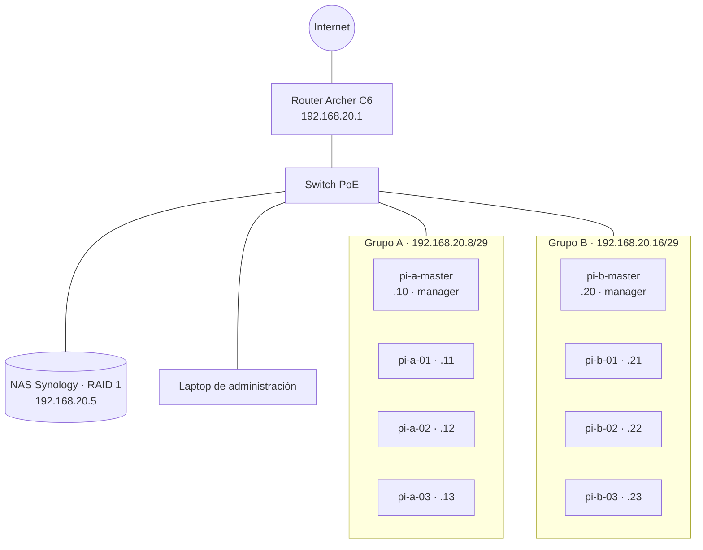

<p align="center">
  
</p>

<h1 align="center">Fundamentos de Clusters con Raspberry Pi</h1>

<p align="center">
  <b>Recursos de programación del Manual del Participante</b><br>
  Academia STEM Iberoamérica · Versión 2026-B · 20 horas · Presencial (laboratorio)
</p>

<p align="center">
  
  
  
  
  
</p>

---

Scripts, archivos de configuración y plantillas listos para usar en cada práctica del curso.
Con ellos los participantes **exploran, verifican y documentan** el cluster del laboratorio:
8 Raspberry Pi 5 divididas en dos clusters independientes de 4 nodos, que comparten switch PoE,
router y NAS.

## Contenido

- [Arquitectura del laboratorio](#arquitectura-del-laboratorio)
- [Ruta de aprendizaje y recursos](#ruta-de-aprendizaje-y-recursos)
- [Requisitos](#requisitos)
- [Inicio rápido](#inicio-rápido)
- [Seguridad del cluster](#seguridad-del-cluster)
- [Convenciones](#convenciones)
- [Solución de problemas](#solución-de-problemas)
- [Créditos](#créditos)

## Arquitectura del laboratorio



Los dos grupos están en la misma red física; el **firewall UFW** de cada nodo bloquea los
puertos de Docker Swarm (`2377`, `7946`, `4789`) desde el grupo contrario.

| Equipo | Grupo | IP | Rol |
|---|---|---|---|
| router | — | `192.168.20.1` | Puerta de enlace y DHCP |
| nas | — | `192.168.20.5` | Almacenamiento compartido (NFS) |
| pi-a-master · pi-a-01 · pi-a-02 · pi-a-03 | A | `.10` · `.11` · `.12` · `.13` | Manager + 3 workers |
| pi-b-master · pi-b-01 · pi-b-02 · pi-b-03 | B | `.20` · `.21` · `.22` · `.23` | Manager + 3 workers |

## Ruta de aprendizaje y recursos

| # | Módulo | Carpeta | Recursos principales |
|:-:|---|---|---|
| 1 | Introducción a la computación en cluster | [`practica-01-cluster-humano`](practica-01-cluster-humano/) | Hojas del "cluster humano", suma paralela, simulador de la Ley de Amdahl |
| 2 | Hardware, PoE y ensamblaje | [`practica-02-hardware`](practica-02-hardware/) | Calculadora del presupuesto PoE, tabla nodo → puerto |
| 3 | Linux y administración remota | [`practica-03-ssh`](practica-03-ssh/) | Información del nodo, copia de llaves SSH, consulta de varios nodos |
| 4 | Redes y direccionamiento IP | [`practica-04-red`](practica-04-red/) | Diagnóstico de red, prueba de aislamiento, calculadora de subredes, reglas UFW |
| 5 | Contenedores con Docker | [`practica-05-docker`](practica-05-docker/) | `compose.yaml` WordPress + MariaDB, prueba de persistencia |
| 6 | Orquestación con Docker Swarm | [`practica-06-swarm`](practica-06-swarm/) | Verificación del swarm, balanceo de carga, prueba de falla guiada |
| 7 | Almacenamiento compartido y Portainer | [`practica-07-nfs-portainer`](practica-07-nfs-portainer/) | Verificación NFS, archivos compartidos, tablero de monitoreo |
| 8 | Proyecto integrador | [`practica-08-proyecto`](practica-08-proyecto/) | `stack.yml`, despliegue, pruebas con CSV, plantilla de documentación |

**Recursos complementarios**

| Carpeta | Para qué |
|---|---|
| [`ejemplo-wordpress`](ejemplo-wordpress/) | Sitio WordPress que se instala y publica entradas de ejemplo automáticamente (módulos 5 y 8). |
| [`retos`](retos/) | Retos de integración: π en paralelo, monitoreo global y respaldo de la base de datos. |
| [`laboratorio-virtual`](laboratorio-virtual/) | Cluster de 4 nodos en tu laptop con Docker in Docker (Anexo F). |
| [`comun`](comun/) | Plan de direccionamiento y funciones que comparten los scripts. |

Cada carpeta tiene su propio `README.md` con los comandos exactos, la sección del manual
que le corresponde y la evidencia que va al portafolio.

> [!NOTE]
> **Cómo usar estos recursos.** Primero realiza el procedimiento del manual escribiendo
> tú los comandos; después usa el script para **comprobar** tu resultado. Los scripts
> muestran cada comando que ejecutan (líneas que empiezan con `$`) para que los
> reconozcas y puedas repetirlos a mano.

## Requisitos

| Dónde | Qué se necesita |
|---|---|
| Laptop | Terminal (PowerShell, o Terminal en macOS/Linux), cliente SSH, Python 3.9+ y, para el laboratorio virtual, Docker Desktop |
| Nodos | Raspberry Pi OS 64 bits con el usuario `cluster`, Docker y las herramientas base del Módulo 3 (`git curl htop nfs-common ufw netcat-openbsd`) |

Los scripts de Python no requieren librerías externas.

## Inicio rápido

**1. Obtén el repositorio en tu laptop**

```bash
git clone <url-del-repositorio> clusters
cd clusters
```

**2. Copia los recursos al maestro de tu grupo** (Grupo B: `192.168.20.20`)

```bash
scp -r comun practica-0* ejemplo-wordpress retos cluster@192.168.20.10:~/recursos/
```

**3. Ejecuta los scripts indicando tu grupo** (`a` o `b`)

```bash
ssh cluster@192.168.20.10
cd ~/recursos
bash practica-04-red/diagnostico_red.sh a
bash practica-06-swarm/verificar_swarm.sh a
```

**Herramientas que corren en la laptop**

```bash
python practica-01-cluster-humano/simulador_amdahl.py --tiempo 600
python practica-02-hardware/presupuesto_poe.py --nodos 8 --consumo 12 --budget 120
python practica-04-red/calculadora_subred.py --laboratorio
```

## Seguridad del cluster

> [!IMPORTANT]
> El cluster del laboratorio **ya está armado y configurado**. La mayoría de los scripts solo leen
> el estado del sistema. Los que lo modifican piden escribir `si` antes de continuar.

| Tipo | Scripts | Cuándo usarlos |
|---|---|---|
| ◆ Exploración | `diagnostico_red.sh`, `verificar_*.sh`, `monitoreo.sh`, `info_nodo.sh` | En cualquier momento |
| ⚡ Pruebas de falla | `prueba_falla.sh`, `pruebas.sh` | Solo con autorización del instructor; apagan **un worker**, nunca el maestro |
| ↻ Guía de referencia | `ufw_grupo.sh`, `formar_swarm.sh`, `montar_nfs.sh` | Solo en un cluster nuevo o en el laboratorio virtual |

> [!WARNING]
> Ejecutar una guía de referencia en el cluster del laboratorio (reiniciar el firewall, volver a
> inicializar el swarm o duplicar `/etc/fstab`) puede dejarlo fuera de servicio para todo el grupo.

## Convenciones

- Usuario de los nodos: `cluster`. Acceso por llave SSH (Práctica 3).
- Plan de direccionamiento centralizado en [`comun/nodos.conf`](comun/nodos.conf).
- Carpeta del NAS: `/mnt/cluster-data/grupo-a` o `/mnt/cluster-data/grupo-b`.
- Las contraseñas de los archivos YAML (`raiz123`, `wp123`, `cluster2026`) son **solo para el laboratorio**.
- Los scripts `.sh` conservan finales de línea LF (`.gitattributes`) para funcionar en las Raspberry Pi
  aunque se editen en Windows.

## Solución de problemas

| Síntoma | Causa probable | Solución |
|---|---|---|
| `Uso: ... <a\|b>` | Falta el argumento del grupo | Agrega `a` o `b` al final del comando |
| `$'\r': command not found` | El script se guardó con finales de línea de Windows | `sed -i 's/\r$//' script.sh` |
| `Permission denied (publickey)` | La llave SSH no está en el nodo | `practica-03-ssh/copiar_llave.ps1` |
| `This node is not a swarm manager` | El script se ejecutó en un worker | Ejecútalo en `pi-a-master` o `pi-b-master` |
| `.local` no resuelve | UFW bloquea mDNS | Conéctate por dirección IP |

## Créditos

Material desarrollado por el equipo académico y técnico de **Academia STEM Iberoamérica**
con fines formativos, educativos y no lucrativos.

Se distribuye bajo la licencia [CC BY-NC-SA 4.0](LICENSE): puedes compartirlo y adaptarlo
citando a Academia STEM Iberoamérica, sin fines comerciales y con la misma licencia.
El logotipo de la institución no está incluido en la licencia.
